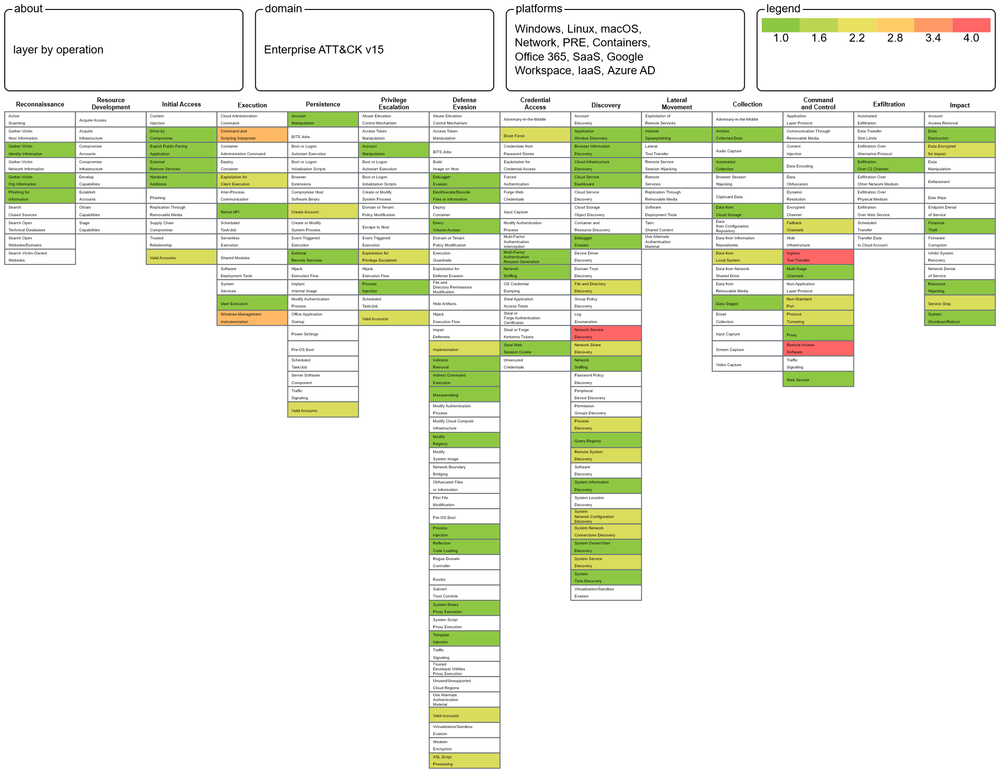
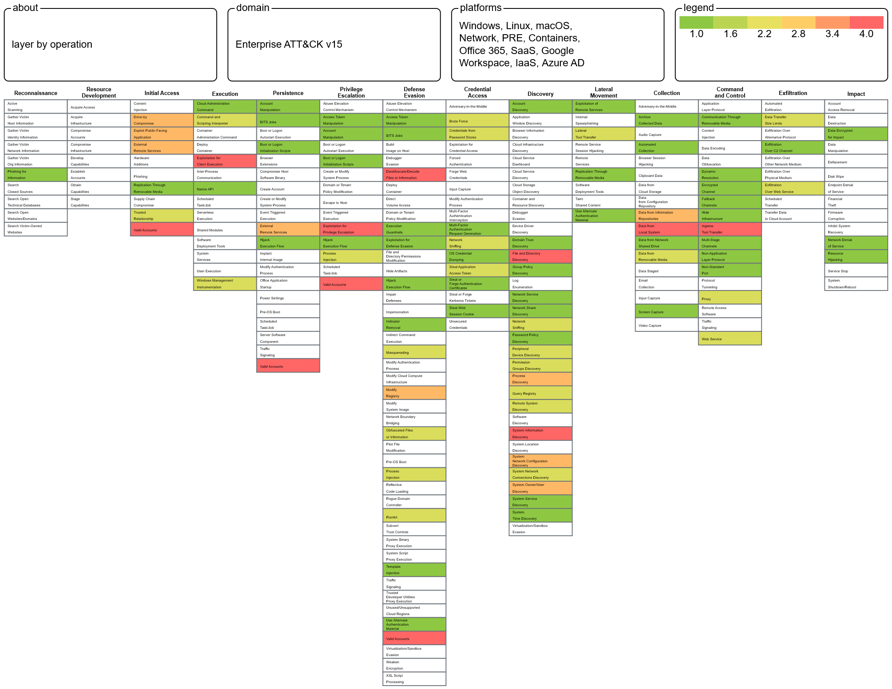

# 🧭 APT Risk Assessment Using MITRE ATT&CK

This is a threat-informed risk assessment that answers one question: **which advanced persistent threat (APT) groups pose the greatest risk to a U.S. financial institution, and can we defend against how they operate?**

I screened the MITRE ATT&CK group database, ranked the most dangerous actors, mapped their techniques in **ATT&CK Navigator**, and compared each critical technique against the organization's defensive capabilities.

## 🔬 Methodology

1. **Collect:** Filtered MITRE ATT&CK groups to those with a history of attacking U.S. targets. That left **41 groups targeting the financial sector** and **31 targeting government**.
2. **Score:** Researched each group's past campaigns, targets, and sophistication, then gave each a **Danger Score (1–5)**. Groups that attacked banks/credit unions, or high-value government bodies (DoD, Pentagon, White House), scored 5.
3. **Select:** Kept the highest-risk groups for each sector.
4. **Map:** Loaded the groups into **ATT&CK Navigator** to build heatmaps of overlapping techniques. Red cells are techniques shared by the most groups.
5. **Assess:** For each critical technique, documented the MITRE description, the business danger, and the organization's mitigating controls.

## 🕵️ Highest-Risk Threat Actors

| Financial Sector | Government Sector |
|---|---|
| Scattered Spider · APT1 · Indrik Spider · Carbanak · Cobalt Group · Dark Vishnya · Lazarus Group | APT41 · APT19 · Sofacy (APT28) · Turla · APT29 · APT33 |

## 🔥 ATT&CK Heatmaps

| Financial APT Groups | Government APT Groups |
|---|---|
|  |  |

## ⚠️ Critical Techniques & Defenses

### Financial Sector
| Tactic | Technique | Key Defenses |
|---|---|---|
| Resource Development | Obtain Capabilities: Tool (T1588.002) | Layered defense-in-depth |
| Execution | PowerShell (T1059.001) | Application allowlisting, script logging, least privilege |
| Execution | Windows Command Shell (T1059.003) | Application allowlisting, network segmentation, monitoring |
| Persistence / Priv. Esc. | Windows Service (T1543.003) | Allowlist approved services, audit existing services, patching |
| Defense Evasion | Masquerading: Match Legitimate Name/Location (T1036.005) | File integrity monitoring, EDR, regular audits, user training |
| Discovery | Network Service Discovery (T1046) | Network segmentation, firewall rules, device authentication |
| Command & Control | Ingress Tool Transfer (T1105) | Segmentation, firewall rules, least privilege, IDS/IPS |
| Command & Control | Remote Access Software (T1219) | Restrict remote access, MFA and strong passwords, secure VPN, logging |

### Government Sector
| Tactic | Technique | Key Defenses |
|---|---|---|
| Initial Access | Spearphishing Attachment (T1566.001) | Attachment scanning/blocking, antivirus, phishing training |
| Execution | PowerShell (T1059.001) | Application allowlisting, script logging |
| Persistence | Registry Run Keys / Startup Folder (T1547.001) | Application allowlisting, registry and startup-folder monitoring |
| Privilege Escalation | Exploitation for Privilege Escalation (T1068) | Isolation and sandboxing |
| Defense Evasion | Obfuscated / Decoded Files (T1027, T1140) | File/process monitoring, EDR, signature and heuristic detection |
| Discovery | System Information Discovery (T1082) | Encryption, network segmentation, log review |
| Collection | Archive via Utility (T1560.001) | Audits, application allowlisting, EDR |
| Command & Control | Web Protocols (T1071.001) | Deep packet inspection, SSL/TLS inspection |
| Command & Control | Ingress Tool Transfer (T1105) | Segmentation, firewall rules, IDS/IPS |

## 🛡️ Top Recommendations

- **Network segmentation** to limit lateral movement and protect critical systems
- **Application allowlisting** and PowerShell/script logging
- **EDR + centralized log monitoring** (SIEM) for behavioral detection
- **Strong email security** and ongoing phishing awareness training
- **Strict remote access controls**: MFA, approved tools only, VPN
- **Patching, service auditing, and system hardening** to shrink the attack surface

## 📄 Full Report

📥 [`Risk Assesmrnt Project.docx`](<Risk Assesmrnt Project.docx>) has the full analysis, including MITRE descriptions, the danger analysis, and a capability assessment for every technique.
